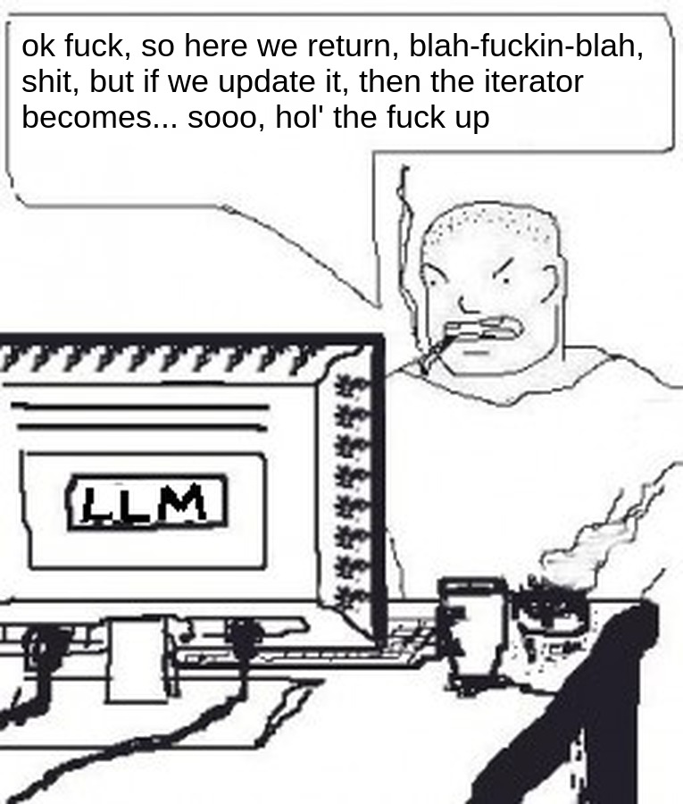

# hunch: Augment, don't replace

Instead of building workflows around an AI harness, build them around the
human to augment their intellect [3]. Keep the proven ideas: Unix
composition, KISS, CSP [14], text as the interface, small tools. LLMs
also excel in the same lean environment.

## Example: voice in Vim

[Demo video][demo]

The human talks to an agent without leaving Vim and without new keys. The
setup:

- iTerm2 runs tmux with two panes: Vim and Claude Code.
- [vim-hunch] serves Vim to its activity as the editor.
- [claude-hunch] marks Claude Code's pane as the agent's.
- [tmux-hunch] is loaded in tmux.
- A dictation app, [Handy] or [Pipit], pastes speech into the terminal
  while a key is held.

The human selects a function in Vim, holds the key and says "split this in
two". Vim is in normal mode, so tmux-hunch sends the text to the agent instead
of the editor. The agent asks the editor what is selected, makes the change
through the editor without moving the human's view, or prepares commits and
opens them in Vim for review. In insert mode the same dictation types into
the buffer, as before.

The terminal only carries the paste, so this works over SSH as well: tmux,
Vim and the agent run on a remote machine, the dictation app and iTerm2 on
the local one.
The cursor and the selection say what "this" and "here" mean.

## Example: a review by voice

Put the cursor on a line a reviewer commented on and say "is this fixed?",
then "reply that the next patch fixes it". Nothing to read in a chat: the
review's threads sit on their lines in Vim, the agent's verdict shows next
to them, the draft opens where you type, and nothing is published until
you say so.

Each part does one thing and knows only the format of the next:

- [memex] brings the review, the issues, the CI and the code of a project
  into one record format, whatever servers it uses.
- [vim-memex] is memex inside Vim: it shows the records where you work
  and drafts replies.
- hunch connects the editor, the agent and the voice: with it, all of
  the above works by voice too.
- [withkeys] stores API keys granularly: per command and per project,
  each gets its own and nothing else.

Swap any part, the others stay: another editor, another agent, a local
model, another code review server. Each combination adds power, while
each part stays as simple as it was alone; the model is Unix's, small
tools composed through plain text.

## Example: a document in the browser

A report is written in [Typst] and read where it looks finished: in
Firefox. `typst watch --features html` serves the render and reloads the
page whenever the source changes. [firefox-hunch] serves Firefox to
hunch by native messaging; the agent of the activity the human is in
reads it.

The human selects a sentence or any other part of the page, a figure, a
table, corrects it by voice and gets the result back: the agent reads
the selection from the browser, changes the Typst source, and the page
reloads.

## Why

Engelbart named the goal: augmenting human intellect, "increasing the
capability of a man to approach a complex problem situation" [3]. He saw
the human as part of a system: a Human using Language, Artifacts, Methodology,
in which he is Trained (H-LAM/T). The system improves as a whole, never by one
artifact alone.

hunch grew out of practice and came to the same view. An agent is a new
artifact. Put inside a new editor or a chat window, it asks the human to drop
their training: their editor, their keys, their way of working. hunch adds
agents to the system the human already has:

- Human: stays the center. Agents and tools work around what the human works
  on.
- Language: plain text protocols that a person can read and a shell can run.
- Artifacts: the editor, the terminal, the agents. Each one can be replaced.
- Methodology: small edits happen live in the human's editor; larger changes
  come as a series of commits to review.
- Training: the human keeps their editor, keys and habits.

## Why not

ACP, the Agent Client Protocol [\[17\]][17]: the editor starts the agent as its
child and shows it in its own panel. The editor becomes the center instead of
the human's work, and the agent lives only as long as that editor. The human
has to use an editor that implements ACP and talk to the agent through its
panel. Only two programs take part: one editor and its agent. Other agents,
tools and hosts have no place in it.

MCP, the Model Context Protocol [\[18\]][18]: the AI harness is the center and
everything else is its tool. Editor integrations of agents, such as Claude
Code's, are built on it: the editor runs a server for one vendor's agent, found
through that vendor's lock files. Each editor implements each vendor's
protocol, which is the coupling hunch avoids. It serves the model, not the
human.

AI editors such as Cursor: the human gives up their editor and habits for the
vendor's. Models, harnesses and editors keep changing, and each change means
moving again.

Agents inside an editor, as plugins: each editor rebuilds the agent, and the
human can't use an agent from elsewhere. The agent stops with the editor.

Plain tmux, sending keys to a pane: text without structure. The agent can't
ask where the cursor is or make an edit that keeps the human's view.

hunch takes ideas from all of them. It doesn't exclude them either: an ACP
agent or an MCP server can serve itself to a workspace through an adapter.

## Principles

The center is whatever the human works on. People work best focused on one
thing: switching between too many things breaks the natural flow.

hunch stays at the periphery of the human's attention: a tray, a pill
while it works, a menu when they open it. It comes to the center when
they call it and leaves again, as calm technology does [8]; the
center stays theirs.

Nothing is fixed: models, harnesses, editors, project tools, and the AI tooling
field itself keep changing. The approach should absorb whatever comes next
without redesign.

Input and output (text, voice, keystrokes, pipes, TCP, etc.) are separate and
interchangeable.

## Model

A device is what the human or an agent uses: an editor, a browser, a
microphone, the windows, the models. Each serves a tree of files, as the
devices of Plan 9 and Inferno do, and the same files work with whatever
program is behind them.

A host owns devices: those of the seat, where the human sits, and those
it runs, such as its models.

A workspace is a name space assembled from devices mounted in it. One
host owns it, though its devices may come from several hosts. Each
activity has its own, with its editor, its browser and its agent; the
human moves between activities by moving between windows.

Programs in a workspace reach each other only through its files: an
agent sees the human's editor as `seat/editor/`, whichever editor and
host it is.

## Getting started

Needs tmux, git, jq, Rust to build hunch-host, and Vim 9.

Install `hunch-host`, `hunch-9p` and `hunch-browser-native` with
`cargo install --path host`, and link `skills/hunch` into
`~/.claude/skills`. hunch-9p starts hunch-host when it isn't running;
with systemd, run it as a user unit instead, to restart it after an
upgrade:

    sed "s|@HUNCH_HOST@|$(command -v hunch-host)|" \
        host/dist/hunch-host.service \
        > ~/.config/systemd/user/hunch-host.service
    systemctl --user enable --now hunch-host

The rest with the plugin managers you use:

- [vim-hunch] and vim-fugitive in Vim
- [tmux-hunch] in tmux
- [claude-hunch] in Claude Code:
  `/plugin install hunch --marketplace roolebo/claude-hunch`.

In one tmux window, run `vim` in one pane and `claude` in another. The
window is an activity: Vim serves itself as its editor, and the agent
reaches it in the activity's workspace:

    hunch-9p read seat/editor/context

To talk to the agent from Vim, dictate through the seat, which types
into the window in focus or into the one you redirect it to:

- on a Mac, the Hunch app: `make -C macos`, then open
  `macos/build/Hunch.app`; it has hunch-seat, hunch-host, hunch-9p and
  hunch-browser-native inside
- under GNOME, `cargo install --path seat` and the Shell extension:
  copy `gnome/hunch@hunch` into `~/.local/share/gnome-shell/extensions`,
  log in again and run `gnome-extensions enable hunch@hunch`

Any dictation app that pastes into the terminal works too, e.g. [Handy]
on Linux, macOS and Windows, or [Pipit] on macOS.

## Tree protocol

Specified in [skills/hunch/TREE.md](skills/hunch/TREE.md).

## Editor protocol

Specified in [skills/hunch/PROTOCOL.md](skills/hunch/PROTOCOL.md).

## Seat protocol

Specified in [skills/hunch/SEAT.md](skills/hunch/SEAT.md);
[seat](seat) serves it.

## Browser protocol

Specified in [skills/hunch/BROWSER.md](skills/hunch/BROWSER.md).

## Inference protocol

Specified in [skills/hunch/INFERENCE.md](skills/hunch/INFERENCE.md).

## Inference

A Mac transcribes on its own models, local:, which hunch-seat serves. A
host that runs none, or the human who'd rather use a workstation,
mounts an OpenAI-compatible server on `inference/` in
`~/.config/hunch/namespace`, as INFERENCE.md says; the tray's settings
write it for them:

    mount http://thinkstation:8080/v1 /inference

A server's key isn't in a file: each host keeps its own in the OS's
store of secrets, the Keychain on macOS and the Secret Service on Linux:

    printf '%s\n' "$KEY" | hunch-9p write inference/login

With http, anyone on the network between them sees the key and the
speech.

## Browser

Install [firefox-hunch], then let Firefox run its bridge, once:

    hunch-browser-native --install

On a Mac, run the one inside the Hunch app,
`Hunch.app/Contents/MacOS/hunch-browser-native`. Firefox starts the
bridge with the extension; the agent of the activity the human is in
reads the browser.

## Agents

Agents reach their activity's workspace with `hunch-9p`, from any
program. The repo comes with the `hunch` skill, which tells them how.

## Version

0.1.0, an early concept that changes as devices join. Until 1.0 a
breaking change bumps the minor version. Each device states the version it
implements.

## Integrations

- [vim-hunch]: Vim as an editor
- [firefox-hunch]: Firefox as a browser
- [tmux-hunch]: pastes in an editor go to the agent
- [claude-hunch]: Claude Code, guard and registration as an agent

[vim-hunch]: https://github.com/roolebo/vim-hunch
[firefox-hunch]: https://github.com/roolebo/firefox-hunch
[vim-memex]: https://github.com/roolebo/vim-memex
[tmux-hunch]: https://github.com/roolebo/tmux-hunch
[claude-hunch]: https://github.com/roolebo/claude-hunch
[Handy]: https://handy.computer
[Typst]: https://typst.app
[Pipit]: https://www.pipitvoice.com
[demo]: https://youtu.be/s8I2Pvz_eYo

## Related

- [memex]: a project's review threads, issues and CI results in one format
- [withkeys]: API keys from pass for the commands that need them
- [caveman-micro]: a six-line prompt that keeps an agent's replies short

[memex]: https://github.com/roolebo/memex
[withkeys]: https://github.com/roolebo/withkeys
[caveman-micro]: https://github.com/kuba-guzik/caveman-micro

## References

Augmentation:

1. Vannevar Bush, As We May Think, The Atlantic, July 1945
2. J. C. R. Licklider, Man-Computer Symbiosis, 1960,
   doi:10.1109/THFE2.1960.4503259
3. Douglas Engelbart, Augmenting Human Intellect: A Conceptual Framework,
   1962, doi:10.21236/AD0289565

Ubiquitous and calm computing:

4. Mark Weiser, The Computer for the 21st Century, 1991,
   doi:10.1038/scientificamerican0991-94
5. Norman Adams, Rich Gold, Bill N. Schilit, Michael Tso, Roy Want, An
   Infrared Network for Mobile Computers, USENIX, 1993
6. Bill Schilit, Norman Adams, Roy Want, Context-Aware Computing
   Applications, 1994, doi:10.1109/WMCSA.1994.16
7. Roy Want et al., An Overview of the PARCTAB Ubiquitous Computing
   Experiment, 1995, doi:10.1109/98.475986
8. Mark Weiser, John Seely Brown, Designing Calm Technology, Xerox PARC,
   1995

Plan 9 and Inferno:

9. Rob Pike, 8½, the Plan 9 Window System, Summer USENIX, 1991
10. Rob Pike, Dave Presotto, Ken Thompson, Howard Trickey, Phil
    Winterbottom, The Use of Name Spaces in Plan 9, 1993,
    doi:10.1145/155848.155861
11. Dave Presotto, Phil Winterbottom, The Organization of Networks in
    Plan 9, Winter USENIX, 1993
12. Sean Dorward et al., The Inferno Operating System, 1997,
    doi:10.1002/bltj.2028
13. Rob Pike, Dennis Ritchie, The Styx Architecture for Distributed
    Systems, 1999, doi:10.1002/bltj.2169

Software design:

14. C. A. R. Hoare, Communicating Sequential Processes, 1978,
    doi:10.1145/359576.359585
15. Peter Naur, Programming as Theory Building, 1985,
    doi:10.1016/0165-6074(85)90032-8
16. Fred Brooks, No Silver Bullet: Essence and Accidents of Software
    Engineering, 1986, doi:10.1109/MC.1987.1663532

Agent protocols:

17. [Agent Client Protocol][17]
18. [Model Context Protocol][18]

[17]: https://agentclientprotocol.com
[18]: https://modelcontextprotocol.io
