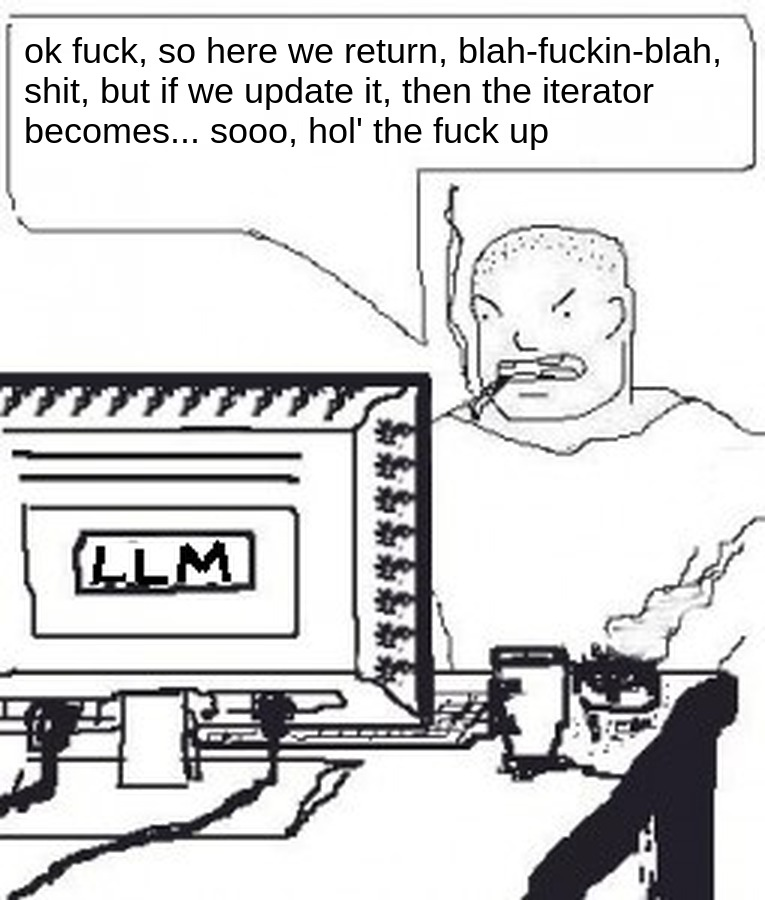

# hunch: Augment, don't replace

Instead of building workflows around an AI harness, build them around the
human to augment their intellect [\[1\]][1]. Keep the proven ideas: Unix
composition, KISS, CSP [\[2\]][2], text as the interface, small tools. LLMs
also excel in the same lean environment.

## Example: voice in Vim

The human talks to an agent without leaving Vim and without new keys. The
setup:

- iTerm2 runs tmux with two panes: Vim and Claude Code.
- Vim is started with --servername; [vim-hunch] registers it as the editor.
- [claude-hunch] registers Claude Code as an agent.
- [tmux-hunch] is loaded in tmux.
- [Pipit], a dictation app, pastes speech into the terminal while a key is
  held.

The human selects a function in Vim, holds the key and says "split this in
two". Vim is in normal mode, so tmux-hunch sends the text to the agent instead
of the editor. The agent asks the editor what is selected, makes the change
through the editor without moving the human's view, or prepares commits and
opens them in Vim for review. In insert mode the same dictation types into
the buffer, as before.

The terminal only carries the paste, so this works over SSH as well: tmux,
Vim and the agent run on a remote machine, Pipit and iTerm2 on the local one.
The cursor and the selection say what "this" and "here" mean.

## Example: a review by voice

Put the cursor on a line a reviewer commented on and say "is this fixed?",
then "reply that the next patch fixes it". Nothing to read in a chat: the
review's threads sit on their lines in Vim, the agent's verdict shows next
to them, the draft opens where you type, and nothing is published until
you say so.

Each part does one thing and knows only the format of the next:

- [memex] brings the review, the issues, the CI and the code of a project
  into one record format, whatever servers it uses.
- [vim-memex] is memex inside Vim: it shows the records where you work
  and drafts replies.
- hunch connects the editor, the agent and the voice: with it, all of
  the above works by voice too.
- [withkeys] stores API keys granularly: per command and per project,
  each gets its own and nothing else.

Swap any part, the others stay: another editor, another agent, a local
model, another code review server. Each combination adds power, while
each part stays as simple as it was alone; the model is Unix's, small
tools composed through plain text.

## Why

Engelbart named the goal: augmenting human intellect, "increasing the
capability of a man to approach a complex problem situation" [\[1\]][1]. He saw
the human as part of a system: a Human using Language, Artifacts, Methodology,
in which he is Trained (H-LAM/T). The system improves as a whole, never by one
artifact alone.

hunch grew out of practice and came to the same view. An agent is a new
artifact. Put inside a new editor or a chat window, it asks the human to drop
their training: their editor, their keys, their way of working. hunch adds
agents to the system the human already has:

- Human: stays the center. Agents and tools work around what the human works
  on.
- Language: plain text protocols that a person can read and a shell can run.
- Artifacts: the editor, the terminal, the agents. Each one can be replaced.
- Methodology: small edits happen live in the human's editor; larger changes
  come as a series of commits to review.
- Training: the human keeps their editor, keys and habits.

## Why not

ACP, the Agent Client Protocol [\[3\]][3]: the editor starts the agent as its
child and shows it in its own panel. The editor becomes the center instead of
the human's work, and the agent lives only as long as that editor. The human
has to use an editor that implements ACP and talk to the agent through its
panel. Only two participants exist: one editor and its agent. Other agents,
tools and environments have no place in it.

MCP, the Model Context Protocol [\[4\]][4]: the AI harness is the center and
everything else is its tool. Editor integrations of agents, such as Claude
Code's, are built on it: the editor runs a server for one vendor's agent, found
through that vendor's lock files. Each editor implements each vendor's
protocol, which is the coupling hunch avoids. It serves the model, not the
human.

AI editors such as Cursor: the human gives up their editor and habits for the
vendor's. Models, harnesses and editors keep changing, and each change means
moving again.

Agents inside an editor, as plugins: each editor rebuilds the agent, and the
human can't use an agent from elsewhere. The agent stops with the editor.

Plain tmux, sending keys to a pane: text without structure. The agent can't
ask where the cursor is or make an edit that keeps the human's view.

hunch takes ideas from all of them. It doesn't exclude them either: an ACP
agent or an MCP server can join an environment as a participant through an
adapter.

## Principles

The center is whatever the human works on. People work best focused on one
thing: switching between too many things breaks the natural flow.

Nothing is fixed: models, harnesses, editors, project tools, and the AI tooling
field itself keep changing. The approach should absorb whatever comes next
without redesign.

Input and output (text, voice, keystrokes, pipes, TCP, etc.) are separate and
interchangeable.

## Model

A participant is anything that takes part in the work: the human, an editor, an
agent, a tool. Each has a role and an id. Participants share no state.

Participants talk only through channels. A channel connects two of them, as in
CSP, and stays visible from the outside, so it can be inspected and rewired.

An address is a URI that says how to open a channel to a participant. Some
addresses work only inside an environment, some outside too.

An environment is a group of participants that can reach each other. It is a
participant itself, so environments connect and nest.

A registry is where the participants of an environment list themselves while
they run: role, id and addresses. It is optional: addresses can also come from
configuration or messages.

Routing wires the channels: human to agent, agent to editor, agent to tool,
environment to environment.

## Getting started

Needs tmux, git, jq, and Vim with +socketserver.

Put `hunch` and `hunch-editor` from this repo on PATH and link
`skills/hunch` into `~/.claude/skills`. The rest with the plugin managers
you use:

- [vim-hunch] and vim-fugitive in Vim
- [tmux-hunch] in tmux
- [claude-hunch] in Claude Code:
  `/plugin install hunch --marketplace roolebo/claude-hunch`.

In one tmux window, run `vim --servername hunch` in one pane and `claude` in
another. Both register as participants and find each other only within the
window:

    hunch-editor find
    hunch find agent

To talk to the agent from Vim, add a dictation app that pastes into the
terminal, e.g. [Pipit] on macOS.

## Editor protocol

Specified in [skills/hunch/PROTOCOL.md](skills/hunch/PROTOCOL.md).

## Agents

`hunch-editor` finds the editor in the registry and runs its handler.
`hunch-editor guard FILE` exits 2, with the reason on stderr, if FILE must
change through the editor protocol.

The repo comes with the `hunch` skill for agents.

## Version

0.1.0, an early concept that changes as participants join. Until 1.0 a
breaking change bumps the minor version. Each participant states the version
it implements.

## Integrations

- [vim-hunch]: Vim as an editor
- [tmux-hunch]: pastes in an editor go to the agent
- [claude-hunch]: Claude Code, guard and registration as an agent

[vim-hunch]: https://github.com/roolebo/vim-hunch
[vim-memex]: https://github.com/roolebo/vim-memex
[tmux-hunch]: https://github.com/roolebo/tmux-hunch
[claude-hunch]: https://github.com/roolebo/claude-hunch
[Pipit]: https://www.pipitvoice.com

## Related

- [memex]: a project's review threads, issues and CI results in one format
- [withkeys]: API keys from pass for the commands that need them
- [caveman-micro]: a six-line prompt that keeps an agent's replies short

[memex]: https://github.com/roolebo/memex
[withkeys]: https://github.com/roolebo/withkeys
[caveman-micro]: https://github.com/kuba-guzik/caveman-micro

## References

1. Douglas Engelbart, [Augmenting Human Intellect: A Conceptual
   Framework][1], 1962
2. C. A. R. Hoare, [Communicating Sequential Processes][2], 1978
3. [Agent Client Protocol][3]
4. [Model Context Protocol][4]

[1]: https://www.dougengelbart.org/pubs/papers/scanned/Doug_Engelbart-AugmentingHumanIntellect.pdf
[2]: https://www.cs.cmu.edu/~crary/819-f09/Hoare78.pdf
[3]: https://agentclientprotocol.com
[4]: https://modelcontextprotocol.io
